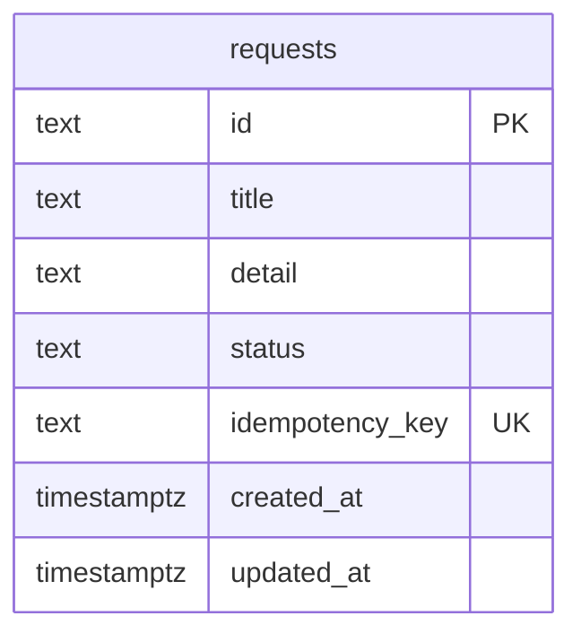

# ERD

Generated from `server/schema.sql`. Refresh this file in the same change as the schema. Do not draw a second diagram by hand.

This capability owns `requests`. Other capabilities reach that data only through `/v1/requests`.

