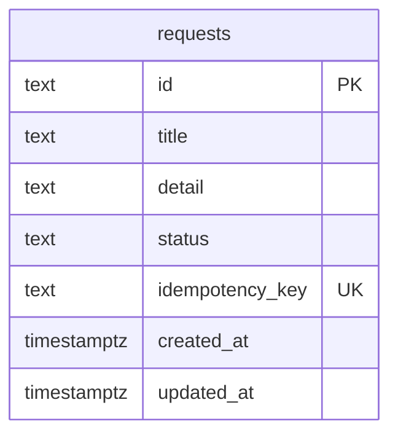

# ERD

Generated from `server/schema.sql`. After migrations run, regenerate this Mermaid file in the same change. GitHub renders it in the pull request. CI regenerates it and fails the build when the committed file differs. Do not draw a second diagram by hand, and do not edit this diagram into a shape the schema does not have.

One ERD per capability. Claude reads it when writing a `/speckit.plan`, so the plan starts from the real model.

This capability owns `requests`. Other capabilities reach that data only through `/v1/requests`. No service reads another service's tables.

